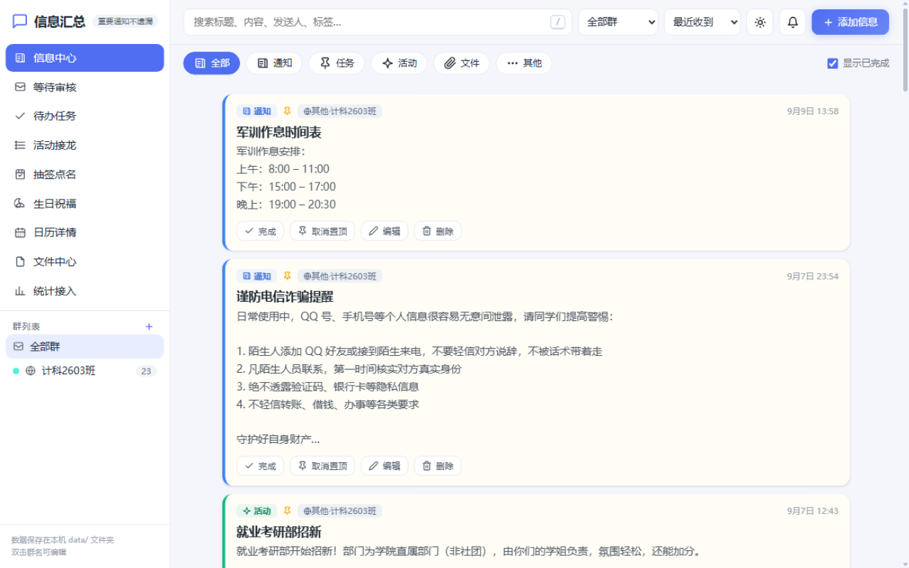
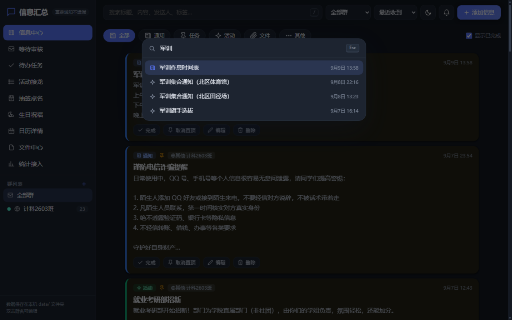
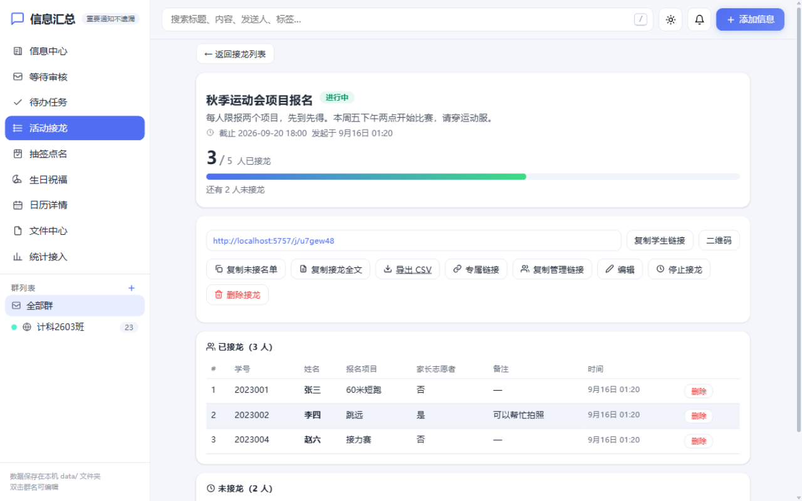
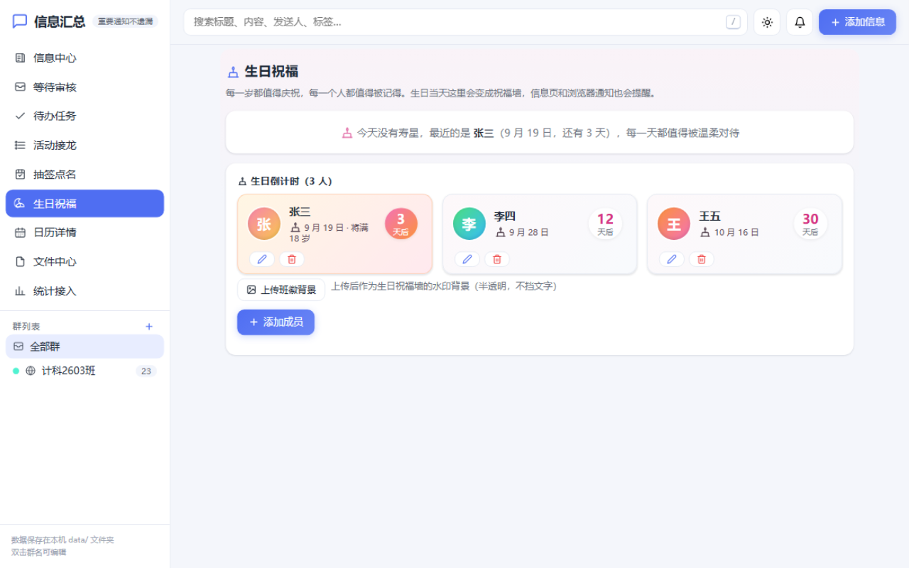

<div align="center">


# 信息汇总 InfoHub

把班级群里的通知、任务、接龙、抽签、投票、问卷、班费、生日汇到一个本地页面，数据存在自己的电脑上。

零依赖 · 手机电脑都能用 · 一条命令启动

[功能一览](#功能一览) · [快速开始](#快速开始) · [部署](#部署) · [QQ 机器人](#qq-机器人接入onebot-11) · [API](#api-一览) · [自检与开发](#自检与开发) · [FAQ](#faq)

[](https://github.com/hsiwf/infohub/actions/workflows/ci.yml)
[](https://github.com/hsiwf/infohub/releases/latest)


[](https://github.com/hsiwf/infohub/pulls)

[下载最新版](https://github.com/hsiwf/infohub/releases/latest) · [问题反馈](https://github.com/hsiwf/infohub/issues)

**为什么做它？** 班级群消息刷屏，重要通知被淹没，活动报名靠刷屏接龙，生日没人记得。
InfoHub 把这些搬到一个本地网页：老师发通知，同学点链接报名，生日自动提醒。

| 信息中心（浅色） | 命令面板 `Ctrl/⌘+K`（深色） |
| --- | --- |
|  |  |
| 活动接龙：自动统计谁还没接 | 生日祝福：生日当天的祝福墙 |
|  |  |

</div>

---

## 功能一览

| 模块 | 亮点 |
| --- | --- |
| **信息中心** | 通知 / 任务 / 活动分色看板，置顶、完成勾选、优先级、全文搜索、按截止时间排序 |
| **待办**（信息中心） | 按"已逾期 / 今天 / 未来 7 天"自动分桶，一键导出手机日历（.ics）、打印清单 |
| **活动接龙** | 生成链接发到班群，同学登录后一键填写（身份取自账号，不用重复输入姓名）；粘贴班级名单自动比对，没接的直接列出来；重名按学号区分、名单外标记、未接名单一键提醒、导出 CSV、扫码接龙 |
| **抽签点名** | 按班级名单抽 N 人：抽过的自动排除、下次不再被抽到，箱内抽空自动开新一轮；自定义人数、撤销、重置、历史留痕 |
| **投票表决** | 选举 / 评优 / 事项表决：资格名单内一人一票（重投=改票），实时票数占比；匿名可选（选票明细仅系统管理员可查）、结果可见时机、限选拦截、未投名单一键提醒、需学号验证防冒名 |
| **问卷调查** | 单选 / 多选 / 评分 / 数字 / 日期 / 文本混合组卷；匿名与记名可切换、可中途调整（转记名后按去重哈希回填身份）；管理员统计图（每题分布条 + 评分平均分）与逐人明细、CSV 导出；可按名单核对匿名期提交人（填写页面向学生明示）；模板复用、独立短链页 `/s/问卷ID` |
| **班费收支** | 收入 / 支出记账，合计与结余实时汇总（金额以「分」存整数杜绝浮点误差）；凭证照片上传内联预览；按类型 / 关键词 / 日期筛选，一键导出 CSV；浏览公开透明，记 / 改 / 删需管理员 |
| **思维碰撞** | 一次一次地收：管理员发起征集（可公开 / 私密、可截止），把 `/c/ID` 链接发到班群，同学点链接或站内提交，不限份数、可匿名、可带文件（比如一篇教程）；每条带待看 / 采纳 / 已实现 / 搁置状态与公开回复。另一个「留言」标签保留原来的寄语墙（昵称、点赞、弹幕、主题筛选） |
| **生日祝福** | 全班生日倒计时；生日当天祝福卡、信息页横幅、浏览器通知；祝福一键复制发班群；可上传班徽水印 |
| **班级管理 · 账号名单** | 一屏管完：名单新建 / 编辑 / 删除 / 复制，展开就是成员表（姓名、学号、身份、账号状态、最近登录），按学号一键开通全班账号（学号即登录名，初始密码是学号后 6 位，库里只存加盐散列）、指定班委、重置密码、停用；接龙、抽签、生日到处复用；支持"学号 姓名"解析（仅管理员可读） |
| **班级管理 · 操作记录** | 所有写操作与登录都留痕（谁、何时、对**哪一条**、来自哪个 IP）：`投出选票《AI科普班会》 张三（2023001） 投给：愿意参加`、`删除信息《班会通知》 正文「…」`、`记一笔班费 支 50.00 元「打印费」`、`抽签点名《计科2603》 第 2 轮抽中 张三、李四`——删除与编辑在动手前先查库拿到对象名，不会再只剩一个 id。登录与退出都留痕并归到具体账号，登录连试错也记（查无此学号 / 密码不对 / 已锁定还硬试，同一 IP 同类失败 5 分钟合并成一条，防刷）。管理员可按人 / 动作 / 日期筛选并导出 CSV；**这一页只有系统管理员能看，班委与同学一律看不到（包括自己那几条）**；滚动保留 180 天 |
| **QQ 机器人** | OneBot 11 接入（NapCat / LLOneBot 等），群消息自动进站；人工审核 / 自动收录两种模式，防闲聊过滤、群白名单、HMAC 签名校验 |
| **命令面板** | `Ctrl/⌘+K` 唤起：视图跳转、常用操作、信息实时搜索；配套全套键盘快捷键（按 `?` 查看） |
| **文件**（信息中心） | 图片 / PDF 在线预览，附件阅读 / 下载次数统计 |
| **统计**（信息中心）/ **设置**（班级管理） | 信息看板、即将截止提醒、分类与群信息量统计；接入地址、OneBot 配置、群管理、备份导入导出在「班级管理 → 设置」 |
| **自动备份** | 每天备份数据库（保留 14 份）、JSON 一键导出 / 导入；数据全部存在本机 `data/` 文件夹 |
| **三档外观** | 浅色 / 深色 / **按时间自动**（19:00–次日 7:00 深色），全站适配深色模式 |

**安全模型**：三级身份 —— **系统管理员**（`config.json` 的 password，管一切）/ **班委**（管理员在「班级管理 → 账号名单」指定学号：发通知与勾选完成、置顶，收录与丢弃待审核，接龙 / 投票 / 抽签点名 / 问卷（含模板）的全套管理——发起、编辑、停止、删除都不区分发起人，改点子的状态与公开回复、删留言）/ **班级同学**（学号 + 密码登录，看通知、交接龙、投票、答问卷、发留言）。班委拿到的是"做事的权限"，不是"看个人信息的权限"：整班学号与匿名投票的选票明细仍只随系统管理员的会话下发，班费、班级名单、账号、备份、操作记录也都碰不到。顶栏随时可退出登录（同学与管理员同一个入口，共享设备友好）。**未登录只能看到登录页**：设了管理密码或开了账号后，所有页面与接口都要先登录，通知、附件、班费、名单不再对互联网敞开。账号密码与管理密码都只存加盐散列（config.json 里写入明文密码重启后自动升级为散列），初始密码是学号后 6 位，登录后应改成自己的。开放写入仅限接龙填写、投票选票、问卷提交、留言发布与点赞四处，各自在接口内校验身份并按 IP 限速。所有写操作、登录、退出与登录失败都进「操作记录」，**只归系统管理员**（班委与同学看不到，包括自己那几条），每条都带上对象名称与内容摘要。公网部署务必设置管理密码。

---

## 快速开始

唯一的前置条件：**Node.js ≥ 22.5**（使用内置 SQLite，无需 `npm install`）。

```bash
git clone https://github.com/hsiwf/infohub.git
cd infohub
node server.js
```

打开 <http://localhost:5757> 即可使用。首次启动自动创建 `data/` 目录与配置文件。

**局域网访问**：启动日志会打印局域网地址（如 `http://192.168.x.x:5757`），手机连同一 Wi-Fi 直接打开；Windows 首次启动在防火墙弹窗勾选"允许访问专用网络"。

**可选配置**（`data/config.json`，改后重启生效）：

| 字段 | 说明 |
| --- | --- |
| `password` | 管理密码。留空 = 不启用；设置后所有人可浏览，增删改需登录（自带限速）。写入明文即可，服务启动时自动升级为加盐散列落盘（`password_hash`），文件里不再保留明文——改密码时重新写入明文并重启，同样会再散列化 |
| `ingestToken` | 投递令牌，仅供机器人 / 快捷指令调 Webhook 投递通知；泄露后改掉重启即可作废 |
| `apiToken` | 管理接口令牌（自动生成），脚本以 `X-Token` 头调用管理接口时使用；与投递令牌分离，泄露互不波及 |

<details>
<summary><b>让电脑开机就运行？</b></summary>

```bash
# pm2（Windows / macOS / Linux 通用）
npm install -g pm2
pm2 start server.js --name infohub
pm2 save && pm2 startup        # 开机自启
```

**Windows** 也可以用 [NSSM](https://nssm.cc/) 把 `node server.js` 注册为系统服务。

升级版本：`git pull && pm2 restart infohub`——数据都在 `data/` 目录，升级不受影响。

</details>

---

## 部署

三种方式按场景三选一，1 核 1G 最低配云服务器即可，全程约 10 分钟。

性能：50 人并发混合浏览实测 1000+ req/s，50 人同时提交接龙 40ms 内全部写入。日常使用离这个量级很远，选服务器时主要考虑宝塔面板、反向代理和 NapCat 的开销（见 [FAQ](#faq)）。

<details open>
<summary><b>方式一：Linux 服务器 + systemd（推荐）</b></summary>

```bash
# 1. 安装 Node.js 22.5+
curl -fsSL https://deb.nodesource.com/setup_22.x | sudo -E bash -
sudo apt-get install -y nodejs

# 2. 获取代码
sudo mkdir -p /opt/infohub && sudo chown $USER /opt/infohub
git clone https://github.com/hsiwf/infohub.git /opt/infohub

# 3. 试运行并放行端口（云厂商安全组 + 本机防火墙均需放行 5757）
cd /opt/infohub && node server.js

# 4. 设置管理密码后注册系统服务
sudo tee /etc/systemd/system/infohub.service <<'UNIT'
[Unit]
Description=InfoHub 信息汇总
After=network.target

[Service]
WorkingDirectory=/opt/infohub
ExecStart=/usr/bin/node server.js
Environment=PORT=5757
Restart=on-failure
RestartSec=5
User=www-data

[Install]
WantedBy=multi-user.target
UNIT
sudo chown -R www-data /opt/infohub/data
sudo systemctl daemon-reload
sudo systemctl enable --now infohub
```

**日常维护**：日志 `journalctl -u infohub -f` 或 `data/logs/server.log`；升级 `git pull && sudo systemctl restart infohub`；备份直接拷 `data/` 文件夹。

</details>

<details>
<summary><b>方式二：宝塔面板（图形界面）</b></summary>

1. 软件商店安装 **Node.js 版本管理器** → 安装 22.x（须 ≥ 22.5）
2. 文件 → 新建 `/www/wwwroot/infohub` → 上传源码（**不要上传本地 data/ 目录**）
3. 网站 → Node 项目 → 添加：项目目录 `/www/wwwroot/infohub`、启动文件 `server.js`、端口 `5757`，勾选守护进程
4. 放行端口 5757（面板 + 云厂商安全组），访问 `http://服务器IP:5757` 验证
5. 可选：绑定域名 + Let's Encrypt 证书（PWA 安装等浏览器能力要求 HTTPS）

</details>

<details>
<summary><b>方式三：Docker</b></summary>

```bash
docker build -t infohub .
docker run -d --name infohub -p 5757:5757 -v infohub-data:/app/data infohub
```

</details>

**Webhook 接入**（快捷指令 / 自动化程序）：

```bash
curl -X POST "http://localhost:5757/api/ingest?token=你的令牌" \
  -H "Content-Type: application/json" \
  -d '{"text":"张老师：下周一下午4点前交自学计划表","group":"三年级二班","sender":"张老师"}'
```

---

## 添加到手机桌面（PWA）

信息中心可以像 App 一样装到手机桌面，点图标直接打开：

**Android（Chrome / Edge）**
1. 手机连同一 Wi-Fi，打开启动日志里的局域网地址（如 `http://192.168.x.x:5757`）
2. 浏览器菜单（右上角 ⋮）→「添加到主屏幕」
3. 未配置 HTTPS 时装的是网页快捷方式；绑域名 + HTTPS 后可独立窗口运行、支持离线缓存，条件满足时顶栏还会出现「安装到桌面」按钮

**iPhone / iPad（Safari）**
1. 用 Safari 打开站点
2. 点底部分享按钮 →「添加到主屏幕」
3. 添加后全屏运行，桌面显示班级图标

> 完整的 App 体验（独立窗口、离线缓存、安装提示）依赖 HTTPS，公网部署绑定域名 + 证书即可获得，见 [部署](#部署)。

---

## QQ 机器人接入（OneBot 11）

在电脑上用 [NapCat](https://napneko.github.io/) / LLOneBot / Lagrange / go-cqhttp 等 OneBot 11 框架登录一个 QQ 小号拉进班级群，网络配置里添加 **HTTP POST 上报**，群消息就会自动进站。

| 配置项 | 值 |
| --- | --- |
| 上报地址 | `http://你的服务器地址:5757/api/onebot/report` |
| access_token | `data/config.json` 的 `onebot.token`（默认与 `ingestToken` 相同） |

统计页「QQ 自动接入（OneBot 机器人）」面板会直接生成上报地址与 NapCat / LLOneBot 配置示例，一键复制。

- **两种收录模式**（`onebot.mode`）：`review` 人工审核（默认，先进「待审核」挑着收录）/ `auto` 自动收录
- **防闲聊过滤**（`onebot.filter`）：最短长度、水词屏蔽（内置"收到""好的"等）、关键词白名单、仅群主/管理员发言、智能过滤；后三项仅 auto 模式参与
- 群白名单按 `ext_key` 绑定站内群，改群名不丢关联；群文件上传自动记录；纯图片/表情不收录；5 分钟内重复上报自动去重
- 可启用 `onebot.secret` 改用 HMAC 签名校验

---

## 活动接龙

侧栏「活动接龙」发起接龙：填标题、粘贴班级名单（Excel / QQ 名单直接粘贴，自动识别"学号 姓名"），生成链接发到班群。

- **同学端**：打开链接或扫二维码 → 用班级账号登录（没登录会先跳登录页，登录后自动回到这一页）→ 页面直接显示「以某某的身份填写」，只填问题就提交。身份取自账号，不用再输姓名或学号；重新提交即覆盖自己那条；页面实时显示已接 / 未接与截止倒计时
- **自动统计**：按名单"槽位"统计（学号+姓名唯一确定一人，重名各归各的）；名单外提交单独标记；编辑名单后已接记录自动重新匹配
- **管理台**：未接名单一键复制提醒文案、复制仿群接龙全文、导出 CSV（Excel 直接打开）、随时编辑 / 停止 / 删除 / 删掉某一条记录
- **班委代管**：班委对列表里每一条接龙都能改、停、删、导出不区分发起人，不必回回借管理员密码；名单整份替换（含学号）仍只在系统管理员手里，班委保存脱敏名单会把学号冲掉

---

## 抽签点名

按班级名单建签箱，每次抽 N 人：

- 抽过的人自动排除，箱内抽空后自动开新一轮
- 人数随时可改；每轮结果留痕，可撤销上一轮或整箱重置
- Fisher-Yates 洗牌 + `crypto.randomInt` 无偏随机；建箱 / 抽签 / 撤销 / 重置 / 改箱 / 删除归管理员与班委（班委同样看不到名单里的学号，也不能整份替换名单），同学可在页面看到每轮结果

---

## 投票表决

班委选举、评优表决、事项表决：发起人设置候选选项与资格名单，同学登录后在站内「投票表决」里直接投，也可以进 `投票ID` 对应的独立投票页投。

- **资格名单控制**：从班级名单选择（或直接粘贴）有资格投票的名单，名单外的同学无法提交；名单每人必须带学号——投票人按登录账号的学号定位，缺学号的人投不了票
- **匿名可选**：匿名投票下同学之间看不到彼此投给谁，选票明细（谁投给谁 + 学号）**只有系统管理员能查——发起投票的班委也看不到**；也可设为记名投票，明细对全班公开，但学号仍只给系统管理员
- **催票与管理的分工**：班委与系统管理员同权地管理每一条投票——发起、编辑（改标题 / 说明 / 截止 / 结果可见时机 / 允许改票，追加选项与追加投票人）、停止、删除都不区分发起人；班委还能看到"谁还没投"（**只给姓名**，够发群里点名催）并复制未投名单提醒。差别只在**看得到谁投给谁**：匿名投票的选票明细、整班资格名单与学号只随系统管理员的会话下发，班委与普通同学一律拿不到；普通同学连未投名单也看不到；即使关掉"允许改票"，能替别人覆盖选票的也只有系统管理员
- **一人一票按账号**：身份来自登录账号，不是"知道谁的名字"；重复提交即改票（截止前），不会重复计票；到截止时间或手动停止后锁定。担心"看到票数后跟风改投"可以关掉改票开关
- **结果可见时机**：一直可见 / 投过票后可见 / 投票结束后可见（最防跟风）；系统管理员始终可见票数，"投过票后可见"按账号判定，猜不出来
- **完成统计**：实时显示已投 / 未投人数与未投名单，一键复制提醒文案，防止漏票与冒票
- **多选支持**：评优选多人时设置「每人最多可选 N 项」
- **发起后可追加**：临时加候选人或加投票人都行，只增不改，已投出的选票不会错位
- 投票入口有两条，同一账号同一张票：站内「投票表决」点开即是**我的投票**面板（本人选票自动回填、投出 / 改票、限选拦截），以及发班群用的独立短链页 `/v/投票ID`（都要登录，手机适配）

---

## 班费收支

班费的每一笔收入与支出透明公示：合计与结余实时汇总，凭证照片留档，人人可查。

- **记账**：收入 / 支出，金额以「分」存整数杜绝浮点误差；按类型（收入 / 支出）/ 关键词 / 日期区间筛选；一键导出 CSV（带合计行与 BOM，Excel 直接打开不乱码）
- **凭证留档**：每条记录可上传多张凭证照片（位图 / PDF 内联预览，缩略图显示在记录行下，点开看大图），记一笔弹窗内联选文件、保存后自动上传
- **权限**：浏览公开透明（人人可看，含结余），记 / 改 / 删需管理员登录；删除记录级联清除凭证
- 纳入备份导出 / 导入；Excel 公式注入已在导出侧中和

## 问卷调查

混合题型的一页式问卷：单选 / 多选 / 评分 / 数字 / 日期 / 文本自由组合，名单内的同学填完自动汇总成统计图。

- **题型丰富**：六种题型混合组卷，每题可选必填、可写补充说明；常用问卷存成模板下次一键套用
- **匿名与记名**：发起时二选一，之后也能在「修改设置」里切换——匿名期谁都不知道是谁填的（想听真话）；转记名后按去重哈希回填身份，管理员可按名单核对每份回答是谁填的（填写页面向学生明示这一规则）；两种模式的边界在发起弹窗里写清
- **统计与明细**：管理员视角顶部是统计图（每题分布条 + 评分平均分），下方逐人明细；班委视角只看统计分布，不看个人；一键导出 CSV（公式注入已中和）
- **提交入口两条，同一账号同一份**：站内「问卷调查」进入详情填写，或发班群的独立短链页 `/s/问卷ID`（都要登录，手机适配）

## 思维碰撞

一次一次地收：先发起一次**征集**（比如「下周活动想做什么」「有什么问题值得我反思」），再把 `/c/征集ID` 的链接发到班群；同学登录后点链接，或在站内「思维碰撞 → 征集活动」里进入同一个征集提交。模块的另一半是原来的**留言**墙（昵称 / 点赞 / 主题 / 弹幕），两类内容各占一个标签。

- **发起与权限**：发起 / 编辑 / 停止 / 删除征集只归系统管理员；同一个人可以在一次征集里提交**多份**（每条各自带状态与回复）
- **公开或私密**：发起时选「全班可见」（互相能看、点赞，适合活动建议）或「仅我与提交人可见」（内容只有发起人和提交人看得到，班委只看到份数，适合反思类问题）；两者都由服务端裁剪，不是前端遮挡
- **私密里也能单独公开**：私密征集的提交框有「匿名展示给全班」（勾上后这一条会匿名出现在全班同学看到的征集里，附件也能下载；没勾的仍然只有发起人与提交人看得到）。公开征集里勾「匿名」本来就是"匿名给全班看"，不需要额外开关
- **点子带状态**：待看 → 采纳 → 已实现（或搁置）；公开征集里管理员与班委都能改，私密征集只归系统管理员。每条下面可以写一条公开回复，提的人能看到"我那条现在怎样了"
- **带附件**：可以和正文一起传文件（比如直接交一篇自己写的教程）：单个 ≤ 20MB、一条最多 5 个、合计 ≤ 40MB；也可以**只传文件不写正文**。正文与文件在服务端同一个事务里落库，传一半失败不会留下半截或孤儿文件；删征集 / 删点子会连带清掉附件
- **署名与匿名**：署名取自登录账号，不用再输名字；勾「匿名」后墙上只显示"匿名"，不显示姓名
- **链接与截止**：`/c/征集ID` 打开后自动进入这次征集（未登录会先去登录页再回来）；可设截止时间，到点自动停止收集，也可以手动「停止收集 / 重新开放」
- **留言墙**：昵称、点赞、主题筛选、最新 / 最热、顶部弹幕都还在；删除留言归管理员与班委
- **操作记录**：发起 / 编辑 / 删除征集、改点子状态与回复都进「操作记录」，能查到谁在什么时候把哪条标成了采纳

---

## 生日祝福

班级成员的生日倒计时和当天祝福。不分老师、同学，都一样记录、一样提醒。

- **生日倒计时**：按天数排序的贺卡列表，7 天内高亮
- **当天祝福墙**：祝福语自动生成或自定义，一键复制发到班群
- **提醒**：信息页顶部横幅、浏览器通知（当天一次）、导航角标
- **班徽背景**：可上传班级徽章作祝福墙水印
- 生日只存月日，年份选填（填了显示"将满 N 岁"）；2 月 29 日平年按 2 月 28 日庆祝

侧栏「生日祝福」→ 从班级名单导入 → 补填生日。

---

## 外观主题

顶栏「深色 / 浅色模式」按钮三档循环：**浅色 → 深色 → 自动**。

- **自动**（默认）：19:00–次日 7:00 自动使用深色，其余浅色，页面开着跨过时间点也会自动切换
- 手动选择浅色 / 深色后固定不变；选择保存在本浏览器
- 学生接龙页、快捷录入页跟随同一主题设置

---

## API 一览

<details>
<summary><b>查看完整 API 列表</b></summary>

| 方法 | 路径 | 说明 |
| --- | --- | --- |
| GET | `/api/health` | 健康检查（版本号、运行时长） |
| GET | `/api/me` | 会话状态（是否需要登录 / 是否已登录 / 访客只读） |
| GET | `/api/config` | 端口、接入令牌、局域网地址、OneBot 配置（仅管理员） |
| GET / POST | `/api/messages` | 信息列表（`q` / `group_id` / `category` / `status` / `sort` / `due` / 分页）/ 新增 |
| GET / PUT / DELETE | `/api/messages/:id` | 详情 / 修改 / 删除（含附件文件）；改与删只归系统管理员 |
| POST | `/api/messages/:id/toggle` · `/pin` | 切换完成 / 置顶（管理员与班委） |
| GET / POST | `/api/groups` | 群列表（`withCounts=1` 带数量）/ 新增（同名 409） |
| PUT / DELETE | `/api/groups/:id` | 修改 / 删除群（群下信息保留） |
| POST | `/api/upload` | 上传附件（multipart/form-data，需 `message_id`） |
| GET | `/api/attachments/:id/download` · `:raw` | 下载附件（`?dl=1` 强制下载；阅读/下载计数） |
| DELETE | `/api/attachments/:id` | 删除附件 |
| GET | `/api/files` | 附件列表（含阅读 / 下载统计；`status=open/done` 按信息完成状态过滤，`limit`/`offset` 分页） |
| POST | `/api/parse` | 智能解析文本（不落库；与其他接口一样需登录） |
| POST | `/api/similar` | 相似信息检测（防重复录入） |
| POST | `/api/ingest?token=` | 外部接入 Webhook |
| POST | `/api/onebot/report` | OneBot 11 HTTP POST 上报（QQ 机器人） |
| GET / POST / PUT / DELETE | `/api/jielong*` | 接龙 CRUD / 填写 / 停止 / 记录删除 / CSV 导出（管理与发起对管理员与班委同权，不区分发起人；整份替换名单与导出里的学号列只归系统管理员；填写按登录账号定位身份） |
| GET / POST / PUT / DELETE | `/api/draw*` | 抽签签箱 CRUD / 抽签 / 撤销 / 重置（建箱与全套动作对管理员与班委同权；名单学号只随系统管理员会话下发，班委不能整份替换名单） |
| GET / POST / PUT / DELETE | `/api/rosters*` | 班级名单（GET 需管理员——名单含学生学号姓名；PUT 用于改名 / 改内容） |
| GET / POST / PUT / DELETE | `/api/vote*` | 投票表决（发起与编辑 / 停止 / 删除对管理员与班委同权；匿名选票明细与整班名单、学号只归系统管理员；选票按登录账号的学号定位） |
| GET / POST / PUT / DELETE | `/api/survey*`、`/api/survey-template*` | 问卷调查：混合题型组卷 / 提交 / 统计 / CSV 导出 / 停止 / 删除；匿名与记名可中途切换（匿名期提交不记身份，管理员明细按名单反查填写人，填写页面向学生明示）；题目在有人提交后锁定；模板单独管理（`/api/survey-template*`，对管理员与班委开放）。提交对登录同学开放，管理对管理员与班委开放 |
| GET / POST / PUT / DELETE | `/api/guestbook*` | 思维碰撞：`kind=note` 是留言墙，`kind=idea` 必须带 `campaign`（提交到某次征集）；可走 multipart 带附件；登录后可浏览 / 发布 / 点赞，按 IP 限速；改状态与回复、删除需管理员或班委（私密征集只归系统管理员） |
| GET / POST / PUT / DELETE | `/api/campaigns*` | 征集活动：列表 / 详情 / 发起 / 编辑（标题、说明、截止、公开或私密、停止收集）/ 删除（连带提交与附件）。发起与管理只归系统管理员；详情按公开 / 私密裁剪提交内容，私密只有系统管理员与提交人看得到 |
| GET / POST / PUT / DELETE | `/api/birthdays*` | 生日成员 CRUD / 名单导入 |
| GET / POST / DELETE | `/api/class-badge` | 班徽背景（上传 / 访问 / 移除） |
| GET | `/api/inbox` | 待审核收件箱列表（管理员与班委） |
| POST | `/api/inbox/:id/accept`、`/api/inbox/accept-all` | 收录待审核消息（管理员与班委） |
| DELETE | `/api/inbox/:id`、`/api/inbox` | 忽略待审核消息（管理员与班委） |
| GET | `/api/calendar.ics` | 导出截止提醒日历（只含未逾期事项） |
| GET | `/api/export` | 导出 JSON 备份（含附件记录、接龙、抽签、班级名单、生日） |
| POST | `/api/import?force=1` | 导入 JSON 备份（事务保护；`force=1` 为合并导入：接龙/抽签按原 id 替换、群按 ext_key 合并、名单同名覆盖、生日同名同日跳过） |
| GET | `/api/stats` | 统计数据 |
| POST | `/api/login` / `/api/logout` | 登录 / 登出：`{sid, password}` 走班级账号（学号 + 密码），`{password}` 走管理员密码 |
| POST | `/api/password` | 本人改密（同学 / 班委；管理员改的是 `config.json` 里的密码） |
| GET / POST / PUT / DELETE | `/api/users*` | 账号管理（仅管理员）：从班级名单批量开号、设班委、重置为初始密码、停用 |
| GET | `/api/audit` / `/api/audit/export` | 操作记录：仅系统管理员可看（可按人 / 动作 / 日期筛选、导出 CSV）；每条含动作、对象名称与内容摘要 |

所有响应均为 JSON；写入类接口在设置了管理密码后需要登录会话（系统管理员或班委，按各自能力清单）或 `X-Token`（`apiToken`，等价于系统管理员）。例外：接龙填写、投票选票、问卷提交、留言发布与点赞、本人改密对登录同学开放，机器人上报凭投递令牌开放；历史上的接龙管理令牌 `?t=` 委托通道已随账号体系退役。

</details>

**环境变量**：`PORT`（默认 5757）· `INFOHUB_DEBUG=1`（打印 API 请求）· `INFOHUB_OPEN=1`（启动自动打开浏览器）· `INFOHUB_DATA_DIR`（改数据目录，默认 `./data`）· `INFOHUB_SELFTEST=1`（自检模式，见下）

---

## 自检与开发

```bash
npm run selftest
```

`selftest.js` 先把真实库连 `config.json`、`uploads/` 一起复制成一份临时快照（数据库用 `VACUUM INTO` 取一致性快照，WAL 模式下直接复制文件会拿到半截状态），再带 `INFOHUB_DATA_DIR=快照 INFOHUB_SELFTEST=1` 起服务、跑 `test.js`，结束时删掉快照。所以一次自检写下的几百条信息、上千条操作记录、备份导入用例都只落在快照上：真实库一个字节都不动，服务被中途杀掉也不会给下一轮留下残留，端口 5757 被你自己的服务占着时它会自动另找端口。

`TEST_KEEP_SNAPSHOT=1 npm run selftest` 会保留快照目录并打印路径，用来人工查看这一轮到底写了什么。

只有你已经在别处手动起好自检服务时，才直接跑 `node test.js`（CI 就是这么用的：它自己起服务，数据目录是干净的临时 `data/`）。脚本对全部 API 做端到端检查（支持无密码 / 密码两种部署形态），全部通过输出 PASS 汇总，任何一项失败以非零码退出。

带 `INFOHUB_SELFTEST=1` 写出的操作记录带 `tag='selftest'`，`test.js` 收尾按标记自动清掉（`TEST_KEEP_AUDIT=1 npm run selftest` 可保留下来人工查看记录内容）。标记只认服务端环境变量，不认请求头——否则谁都能把自己的真实操作伪装成噪声。直接跑 `node test.js` 打普通服务时这套标记不生效，记录会留在库里，所以别那么干。

```
infohub/
├── server.js            # HTTP 服务与全部 API（零依赖）
├── db.js                # SQLite 初始化与表结构（node:sqlite）+ 老库迁移
├── lib/
│   ├── smartparse.js    # 中文通知智能解析（启发式规则）
│   ├── jielong.js       # 活动接龙：名单解析 / 身份匹配 / 进度 / CSV
│   └── multipart.js     # multipart/form-data 解析
├── public/              # 前端（原生 HTML / CSS / JS + PWA）
│   ├── index.html       # 主界面（信息中心：信息流 / 待办 / 待审核 / 文件 / 统计；接龙 / 抽签 / 投票 / 思维碰撞 / 生日 / 班费；班级管理：账号名单 / 操作记录 / 设置）
│   ├── jielong-join.html# 学生接龙页（/j/:id）
│   ├── vote.html        # 学生投票页（/v/:id）
│   ├── survey.html      # 学生问卷页（/s/:id）
│   ├── quick.html       # 快捷录入页
│   ├── login.html       # 管理员登录页
│   └── js/app.js        # 前端逻辑
├── test.js              # 端到端自检脚本（打 API）
├── selftest.js          # 自检启动器：把真实库快照成临时数据目录再跑 test.js，真实库不受影响
├── e2e-matrix.js        # 全模块真实流量测试矩阵：对运行中的服务按模块建→验→删，测试数据自动清理
└── data/                # 运行时生成：数据库、附件、备份、日志、config.json（不入库）
```

---

## FAQ

**端口被占用？** 大概率服务已在运行，直接打开 <http://localhost:5757>；或换端口启动：Linux / macOS `PORT=8080 node server.js`，Windows CMD `set PORT=8080 && node server.js`，Windows PowerShell `$env:PORT=8080; node server.js`。

**能带多少用户？** 50 人并发混合浏览实测 1000+ req/s，50 人同时提交接龙 40ms 内完成（开发机实测）。日常每人几秒到十几秒刷一次，50 人的班级只用到服务端能力的一两个百分点，百人的年级活动也够。瓶颈一般在网络带宽，不在应用。

**备份怎么清理？** 自动备份每天一份，保留最近 14 份，每份通常只有几 MB，一般不用管。要清空就停掉服务，删掉 `data/backups/` 下的文件，下次启动会自动生成当天的备份。`data/` 不进 git，删了不影响仓库。

**手机 / 外网打不开？** 检查三处：同一 Wi-Fi、防火墙已放行端口、云服务器安全组已放行端口。

**忘记管理密码？** 编辑 `data/config.json`，将 `password` 改为 `""`（或新密码）后重启服务。

**如何彻底重置？** 停止服务后删除 `data/` 目录，重启即回到初始状态（先备份需要保留的内容）。

**智能解析不准？** 解析是纯启发式规则，识别结果永远可以在界面上手工修改；欢迎在 Issue 中贴出解析失败的例子。

---

## 数据与安全

- 所有数据都在本机 `data/` 文件夹——**复制整个文件夹即完整备份**（含数据库、附件、配置）
- 每天自动备份数据库到 `data/backups/`（保留 14 份）；JSON 导出 / 导入适合跨机器迁移
- **学生名单、生日属于敏感信息**：请勿公开 `data/` 目录；公网部署务必设置管理密码
- 机器人令牌（`ingestToken`）泄露后改掉重启即可作废旧令牌

---

## 参与贡献

欢迎 Issue 和 Pull Request：Fork 本仓库并新建分支；**保持零依赖原则**——不引入 npm 运行时依赖；提交前运行 `npm run selftest` 确保自检通过。

| 文档 | 说明 |
| --- | --- |
| [CONTRIBUTING.md](CONTRIBUTING.md) | Issue / PR 详细流程、提交信息与兼容性约定 |
| [CHANGELOG.md](CHANGELOG.md) | 版本更新记录 |
| [SECURITY.md](SECURITY.md) | 安全策略、漏洞私下报告流程 |

## 许可证

本项目基于 [MIT License](LICENSE) 开源。
